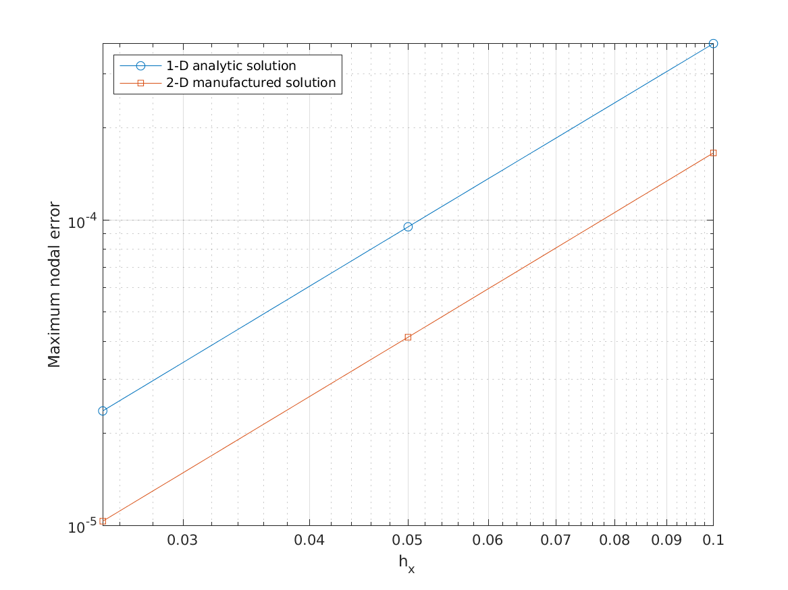
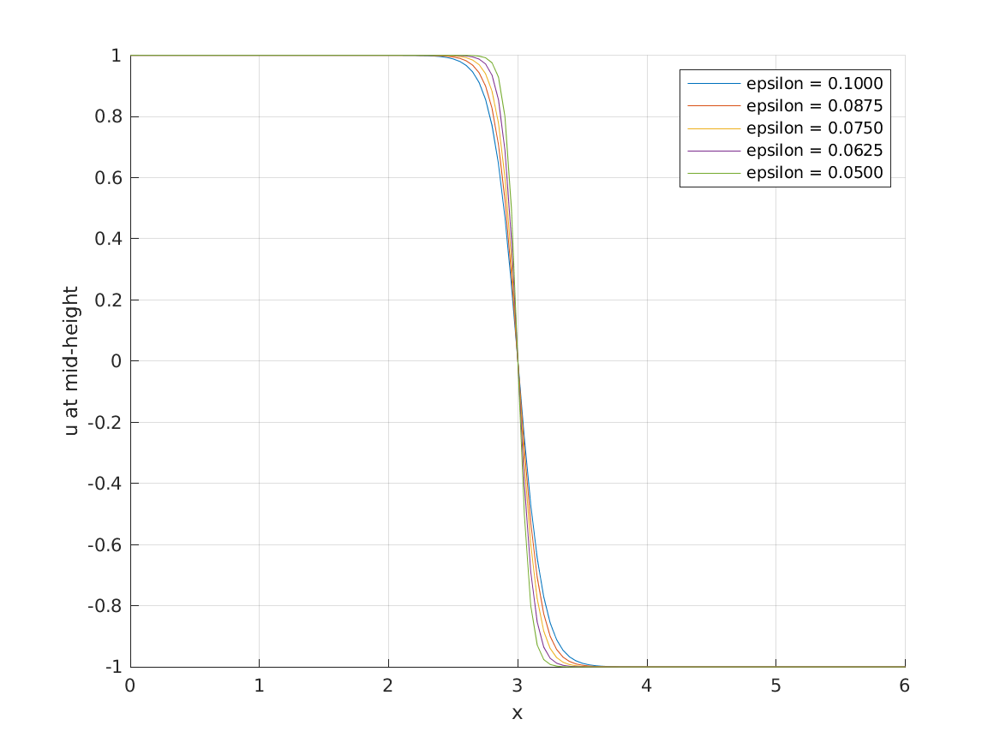

# Numerical Solver for a Nonlinear Equation in MATLAB

[](https://github.com/dchwu2003/Non-linear-PDE-solver/actions/workflows/numerical-validation.yml)

This is a small MATLAB code for solving a nonlinear PDE on a rectangle with finite differences. It started as a team project at the Laboratory of Geometry at Michigan (LoG(M)) in Fall 2025.

## Problem

We study

$$u u_x-u_{yy}=0,\qquad (x,y)\in(0,6)\times(0,5).$$

The $u u_x$ term carries values to the left or right in x. The sign of $u$ sets the direction. The $u_{yy}$ term smooths values in y. This equation is hard to solve directly, so we add a small smoothing term $-\varepsilon u_{xx}$ and solve the modified equation

$$u u_x-u_{yy}-\varepsilon u_{xx}=0$$

on a grid with finite differences.

The default example sets $u=1$ on the left edge and $u=-1.1$ on the right edge. On the top and bottom edges, $u_y=0$.

## Method

1. Start from the solution of a linear version of the problem, which leaves out the $u u_x$ term.
2. Fix the current $u$ in the nonlinear term, so that the equation becomes linear. Solve the resulting sparse linear system. Take half a step from the old solution toward the new one. Repeat until the solution stops changing and the equation is satisfied to a small tolerance.
3. Lower $\varepsilon$ step by step, from 0.1 to 0.05 over five values. Each step starts from the solution of the previous one. The grid stays the same.

[docs/numerical-method.md](docs/numerical-method.md) has the formulas and the standard names for these steps.

The poster's run used boundary values +1 and −1, with ε lowered to 0.01 on a 320×270 grid. This release's default demonstration uses different settings (−1.1 on the right, ε down to 0.05, 121×61 grid).

The default boundary data do not depend on y, so the default solution does not depend on y either. Its plot therefore does not exercise the y direction of the code. A separate test problem whose solution varies in y covers that.

## Results

We used two test problems with known exact solutions, one depending only on x and one depending on both x and y. On both, the error shrinks at the expected second-order rate as the grid is refined: observed orders were 1.993–2.002 and 2.001–2.004 in MATLAB R2024b. At each of the five ε values in the default example, the iteration brought the equation residual below `1e-7`. These checks cover the test problems only. They do not show how accurate the grid is for the thin transition layer in the default example.





[docs/validation.md](docs/validation.md) lists the exact settings, the raw data and the CI run that produced them.

## Run

Use MATLAB R2024b, which is the release the CI uses. No extra toolboxes are needed. Other MATLAB releases have not been tested.

From the repository root:

```matlab
main
```

or call the function directly:

```matlab
result = run_example('results', true);
```

To run without graphics, pass `false` as the second argument. The example saves:

- `example.mat`: settings, grids, solutions, and the iteration history for each ε;
- `continuation.csv`: for each ε, the iteration count, final residual, change from the previous ε, and the cell Péclet number (a measure of grid resolution, explained in [the method notes](docs/numerical-method.md));
- `solution.png`, `residuals.png`, `profiles.png`: figures, when plotting is on.

Generated files go into `results/`, which Git ignores. Copies of the figures and CSV files from the MATLAB CI run are kept in `docs/figures/` and `docs/data/`.

## Tests

```matlab
addpath('tests');
report = run_tests('results', true);
```

The tests cover constant and linear fields, nonzero derivative values on the top and bottom edges, grid ordering on a non-square grid, a check that the solver does not stop too early, invalid inputs, and the two test problems with known solutions. For both test problems, the tests refine the grid at a fixed ε and check that the error decreases at second order. The residual is also recomputed separately from the matrix assembly.

[docs/numerical-method.md](docs/numerical-method.md) gives the formulas and test definitions. [docs/validation.md](docs/validation.md) gives the measured results and run details. The [CI workflow](.github/workflows/numerical-validation.yml) runs the tests and the full example in MATLAB and uploads the outputs and plots.

## Settings and function interface

Edit `default_config.m` to change the example:

| Parameter | Default |
|---|---:|
| Grid nodes `Nx`, `Ny` | 121, 61 |
| Domain lengths `Lx`, `Ly` | 6, 5 |
| ε values | `linspace(0.1,0.05,5)` |
| Left/right boundary values | 1, −1.1 |
| Maximum iterations per ε | 1000 |
| Relative update tolerance | `1e-8` |
| Absolute residual tolerance | `1e-7` |
| Step size toward the new solution (relaxation) | 0.5 |

The original `Initial_guess` and twelve-argument `Nonlinear_iteration` functions still work. `Nonlinear_iteration` also accepts an optional options structure and returns diagnostics:

```matlab
options = struct('relaxation', 0.5, 'residual_tolerance', 1e-8, 'verbose', false);
[u, info] = Nonlinear_iteration(u0, epsilon, hx, hy, Nx, Ny, ...
    bottom, top, left, right, 1000, 1e-9, options);
U = reshape(u, Nx, Ny); % x is the first dimension
```

`bottom` and `top` are derivatives in the positive y direction, **not outward-normal derivatives**. They have length `Nx`. `left` and `right` are fixed values with length `Ny`. At the corners, the left/right values take precedence. For test problems with a source term, `options.forcing` is an `Nx`-by-`Ny` array `f` in the equation `u*ux-epsilon*uxx-uyy=f`.

## Scope and limitations

- As ε gets smaller, the grid needs more points in x. Check `info.max_cell_peclet`, refine the grid, and compare the solutions. A small residual alone does not show that the grid is fine enough.
- The iteration is not guaranteed to converge for every problem. If it does not converge, the code reports this and the example stops.
- The default example has a thin transition layer, and it would need its own grid refinement study.
- This code solves one steady scalar equation. It is not a Navier–Stokes solver and does not do adaptive mesh refinement or multigrid.

## Files

| File | Purpose |
|---|---|
| `main.m` | Script entry point |
| `default_config.m`, `run_example.m` | Settings and the default example |
| `assemble_system.m` | Shared sparse grid operator and boundary handling |
| `Initial_guess.m` | Starting solution from the linear problem |
| `Nonlinear_iteration.m` | Nonlinear iteration and diagnostics |
| `tests/run_tests.m` | Tests and grid refinement checks |
| `docs/` | Method notes and measured results |

## Contributors and provenance

- Team project at the Laboratory of Geometry at Michigan (LoG(M)), Fall 2025. Poster presented December 2025. Mentor: Tian Jing.
- Daocheng Wu: finite-difference discretization and sparse-matrix code; maintenance and final checks; prepared this public release (October 2026) with AI coding assistance, which fixed an error in the iteration, combined the shared grid operator into one routine, added tests and CI, and wrote documentation.
- Other team members: Jiayi Tang, Shen Chang, Yu Wang, Yiling Chen.

The original README links to the [University of Michigan GitLab project](https://gitlab.umich.edu/logm/Fall25/nonlinear-pde-final-code/matlab-code-for-pde.git). This GitHub repository holds the MATLAB code and the scripts that reproduce the results.

## License

[MIT License](LICENSE), as stated in the original README. Please credit the contributors when reusing this work.
