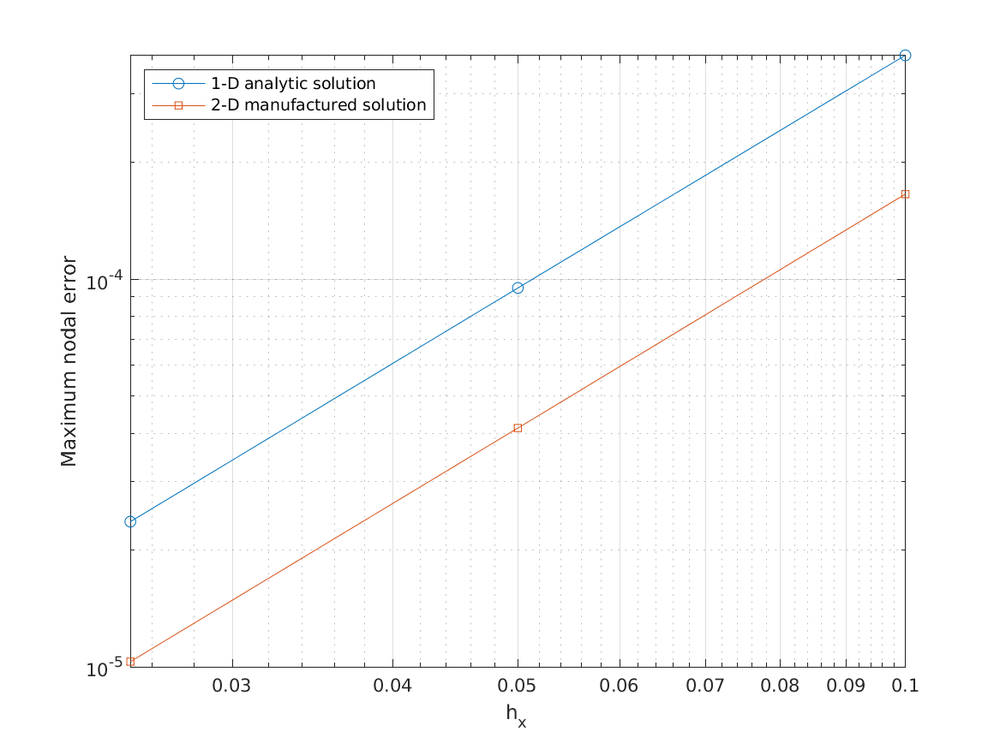
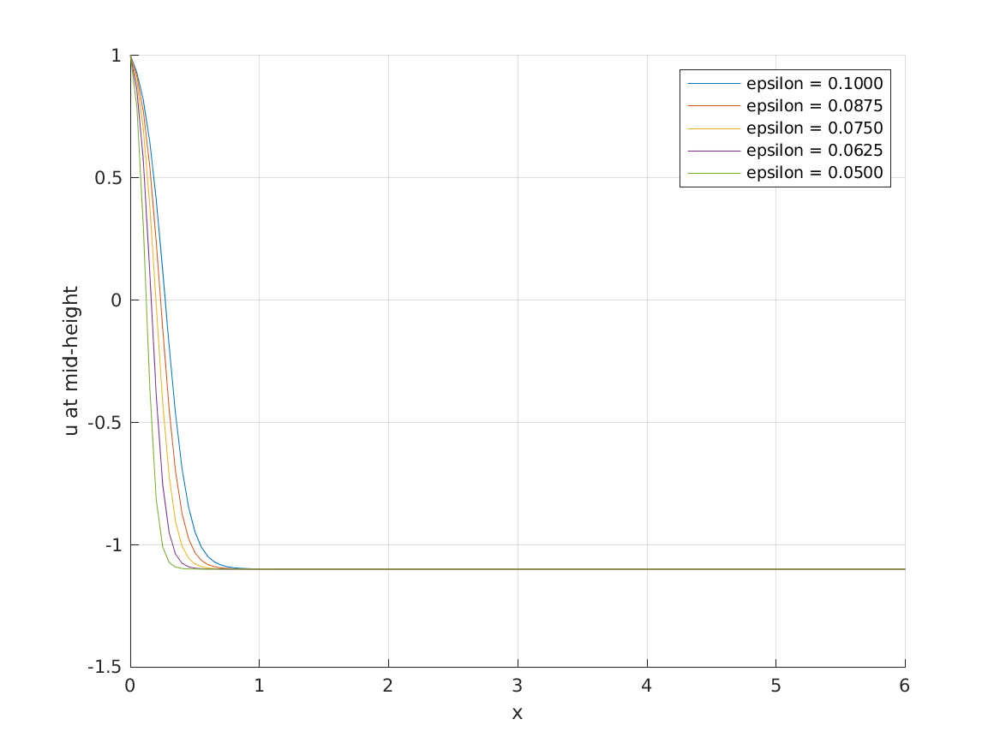

# Nonlinear Convection–Diffusion Solver in MATLAB

[](https://github.com/dchwu2003/Non-linear-PDE-solver/actions/workflows/numerical-validation.yml)

A finite-difference research project for a steady nonlinear convection–diffusion equation. The MATLAB implementation combines damped Picard iteration, sparse linear solves, and fixed-grid continuation in the diffusion parameter. Analytic and manufactured solutions provide numerical verification.

## Problem

$$u u_x-u_{yy}-\varepsilon u_{xx}=0,\qquad (x,y)\in(0,6)\times(0,5).$$

The default demonstration uses

$$u(0,y)=1,\qquad u(6,y)=-1.1,\qquad u_y(x,0)=u_y(x,5)=0.$$

It solves five epsilon values from 0.1 to 0.05, reusing each converged solution as the next initial guess. The grid stays fixed. Grid refinement is a separate validation experiment.

The default data are independent of y, so its surface plot alone does not validate the two-dimensional implementation. A y-dependent manufactured-solution test exercises that behavior explicitly.

## Results

MATLAB R2024b validation measured convergence orders of 1.993–2.002 for the analytic benchmark and 2.001–2.004 for the two-dimensional manufactured solution. All five default continuation stages reached a PDE residual below `1e-7`. These results verify the implemented benchmarks; the grid error of the default thin-layer example requires a separate refinement study.





See [validation results](docs/validation.md) for exact settings, raw data, and the source CI run.

## Run

Use MATLAB R2024b, the release configured in CI. No additional toolboxes are required. Other MATLAB releases are not currently part of the CI matrix.

From the repository root:

```matlab
main
```

or call the function directly:

```matlab
result = run_example('results', true);
```

For a headless run, pass `false` as the second argument. The example saves:

- `example.mat`: configuration, grids, solutions, and per-stage histories;
- `continuation.csv`: epsilon, iteration count, PDE residual, change from the previous epsilon, and maximum cell Peclet number;
- `solution.png`, `residuals.png`, `profiles.png`: figures when plotting is enabled.

Generated files go into `results/` and are ignored by Git. Measured figures and CSV snapshots from MATLAB CI are preserved under `docs/figures/` and `docs/data/`.

## Verify

```matlab
addpath('tests');
report = run_tests('results', true);
```

The suite checks constant and affine fields, nonzero Neumann data, rectangular-grid ordering, false convergence, invalid inputs, a one-dimensional analytic solution, and a two-dimensional manufactured solution. Both benchmarks refine the grid at fixed epsilon and check observed second-order accuracy. Discrete residuals are also evaluated independently of matrix assembly.

See [the numerical method](docs/numerical-method.md) for formulas and test definitions, and [validation results](docs/validation.md) for measured results and runtime provenance. The [CI workflow](.github/workflows/numerical-validation.yml) runs the suite and full demonstration in MATLAB and uploads diagnostics and plots as an artifact.

## Configuration and API

Edit `default_config.m` to change the demonstration:

| Parameter | Default |
|---|---:|
| Grid nodes `Nx`, `Ny` | 121, 61 |
| Domain lengths `Lx`, `Ly` | 6, 5 |
| Epsilon sequence | `linspace(0.1,0.05,5)` |
| Left/right Dirichlet values | 1, −1.1 |
| Maximum Picard iterations per epsilon | 1000 |
| Relative update tolerance | `1e-8` |
| Absolute PDE residual tolerance | `1e-7` |
| Relaxation | 0.5 |

The original `Initial_guess` and twelve-argument `Nonlinear_iteration` entry points remain available. The latter also accepts an optional options structure and returns diagnostics:

```matlab
options = struct('relaxation', 0.5, 'residual_tolerance', 1e-8, 'verbose', false);
[u, info] = Nonlinear_iteration(u0, epsilon, hx, hy, Nx, Ny, ...
    bottom, top, left, right, 1000, 1e-9, options);
U = reshape(u, Nx, Ny); % x is the first dimension
```

`bottom` and `top` are positive-y derivatives, **not outward-normal derivatives**. They have length `Nx`; `left` and `right` have length `Ny`. Dirichlet conditions take precedence at corners. For manufactured problems, `options.forcing` is an `Nx`-by-`Ny` array for the equation `u*ux-epsilon*uxx-uyy=f`.

## Scope and limitations

Centered differences need sufficient x resolution as epsilon decreases. Inspect `info.max_cell_peclet`, refine the grid, and compare solutions; a small algebraic residual alone does not establish discretization accuracy. Damped Picard iteration is not guaranteed to converge for every problem. Nonconvergence is reported explicitly and stops the demonstration.

This repository implements a steady scalar PDE solver. It does not implement a Navier–Stokes solver, adaptive mesh refinement, or multigrid cycles.

## Files

| File | Purpose |
|---|---|
| `main.m` | Script entry point |
| `default_config.m`, `run_example.m` | Parameters and reproducible continuation experiment |
| `assemble_system.m` | Shared sparse diffusion operator and boundary treatment |
| `Initial_guess.m` | Linear diffusion initial guess |
| `Nonlinear_iteration.m` | Damped Picard solve and diagnostics |
| `tests/run_tests.m` | Numerical regression and convergence studies |
| `docs/` | Method and measured validation results |

## Contributors and provenance

Original project contributors: Daocheng Wu, Shen Chang, Jiayi Tang, Yu wang, and Yilin Chen. This repository preserves the team attribution. Individual contribution roles are not specified in the available source history.

The original README references the [University of Michigan GitLab project](https://gitlab.umich.edu/logm/Fall25/nonlinear-pde-final-code/matlab-code-for-pde.git). This GitHub repository provides the reviewable MATLAB implementation and reproducibility workflow.

## License

[MIT License](LICENSE), as stated in the original README. Credit the contributors when reusing this work.
