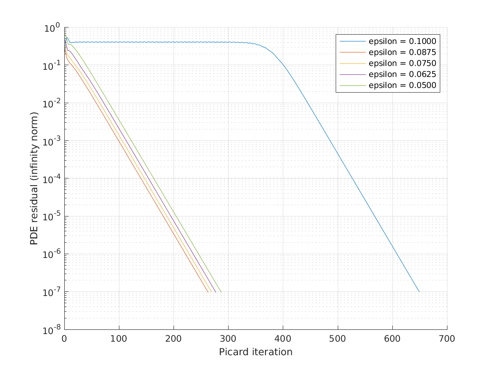
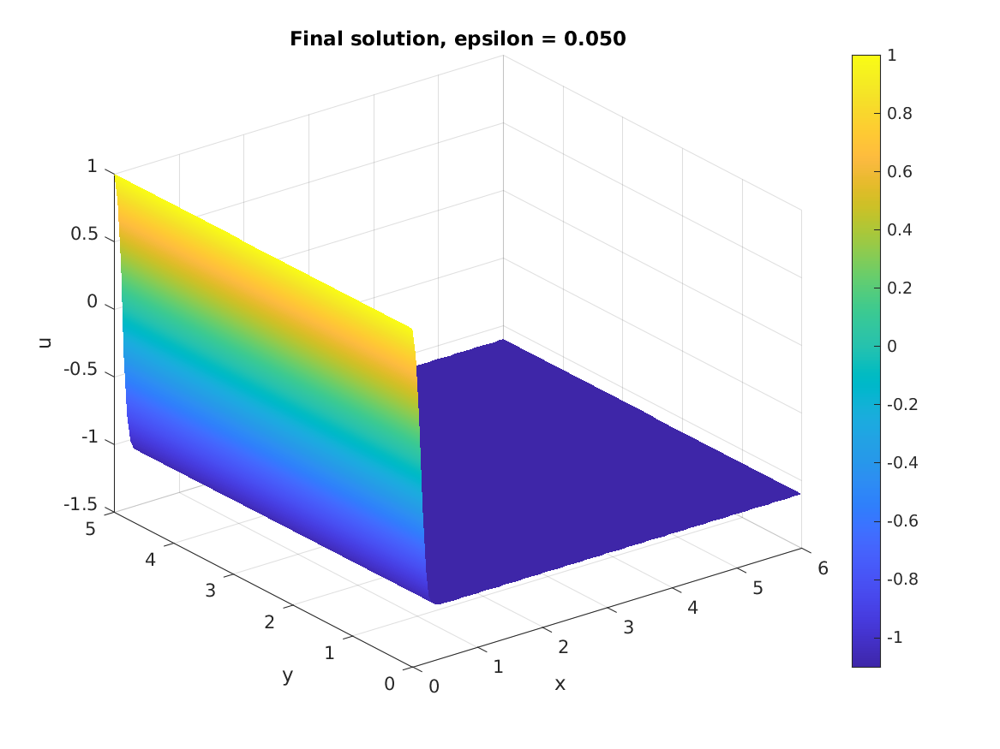

# Measured validation results

The results below were generated on 2026-10-23 by **MATLAB 24.2.0.3361896 (R2024b), Update 10**, on an Ubuntu GitHub-hosted runner. The [source CI run](https://github.com/dchwu2003/Non-linear-PDE-solver/actions/runs/40029637502) passed both numerical regression tests and the full demonstration, including figure generation.

Solver and experiment source commit: [`3a89a08501076936d17c97f0cd1213e4c75a5bb1`](https://github.com/dchwu2003/Non-linear-PDE-solver/commit/3a89a08501076936d17c97f0cd1213e4c75a5bb1). The committed CSVs and figures are snapshots from that run, not manually generated examples. Re-running the commands in the README creates fresh outputs in `results/`; these snapshots are not automatically overwritten.

## Fixed-epsilon grid convergence

Both problems use epsilon 0.2 on `[0,2] x [0,1]`. Both spacings halve between successive grids. Maximum nodal error is measured against an analytic reference; observed order is `log2(error_coarse/error_fine)`.

| Grid | 1-D analytic error | Order | 2-D manufactured error | Order |
|---|---:|---:|---:|---:|
| 21 x 13 | 3.776507e-4 | — | 1.656320e-4 | — |
| 41 x 25 | 9.488772e-5 | 1.9928 | 4.130739e-5 | 2.0035 |
| 81 x 49 | 2.369195e-5 | 2.0018 | 1.032057e-5 | 2.0009 |

The analytic solves each took 48 Picard iterations; the manufactured solves each took 35. Independently evaluated discrete residuals were below `7.1e-12` in every case. For the manufactured problem, the independent Neumann derivative error decreased from `4.2028e-4` to `6.6035e-6` over these grids. Its unusually rapid decrease is specific to this smooth test function and is not a general accuracy claim.

Full precision data: [analytic.csv](data/analytic.csv), [manufactured.csv](data/manufactured.csv). Formulas and boundary conventions are documented in [numerical-method.md](numerical-method.md).

## Default epsilon continuation

The demonstration uses 121 x 61 nodes on `[0,6] x [0,5]`, left/right values 1 and -1.1, zero y derivatives, relaxation 0.5, relative update tolerance `1e-8`, and absolute PDE residual tolerance `1e-7`. Every epsilon is solved; solution changes between epsilon values are diagnostics, not stopping criteria.

| Epsilon | Picard iterations | Final PDE residual | Maximum cell Peclet number |
|---|---:|---:|---:|
| 0.1000 | 649 | 9.8386e-8 | 0.275 |
| 0.0875 | 263 | 9.5291e-8 | 0.314 |
| 0.0750 | 269 | 9.8715e-8 | 0.367 |
| 0.0625 | 277 | 9.5936e-8 | 0.440 |
| 0.0500 | 287 | 9.5548e-8 | 0.550 |

The initial stage has a long residual plateau before converging. A low iteration cap would incorrectly terminate this demonstration. Sparse operators are assembled once per stage, but the Picard method remains relatively slow here; no performance benchmark is claimed.

The stronger negative right boundary moves the transition near the left boundary. The solution is y-independent for these data. The small residuals describe convergence of the discrete nonlinear solve, not the discretization error in the thin layer. The smooth fixed-epsilon benchmarks above establish observed second-order behavior only for their specified settings.

Full precision data: [continuation.csv](data/continuation.csv). The CI artifact `matlab-validation` contains the full solution arrays and histories in `example.mat` and the validation report in `validation.mat`; GitHub's artifact retention policy applies. Figures and CSV snapshots remain in the repository.

## Additional regressions

The same passing run also checked:

- zero and nonzero constant solutions;
- an affine field with nonzero Neumann derivatives and a perturbed initial guess on a rectangular grid;
- independent explicit-stencil residuals and Dirichlet boundary errors;
- rejection of false convergence with tiny relaxation and a large residual;
- invalid epsilon, boundary length, and relaxation inputs;
- decreasing manufactured-solution Neumann derivative error under refinement.

All assertions must pass before CI reports success. The workflow is configured to run on pull requests and branch pushes, using MATLAB R2024b without extra toolboxes.
