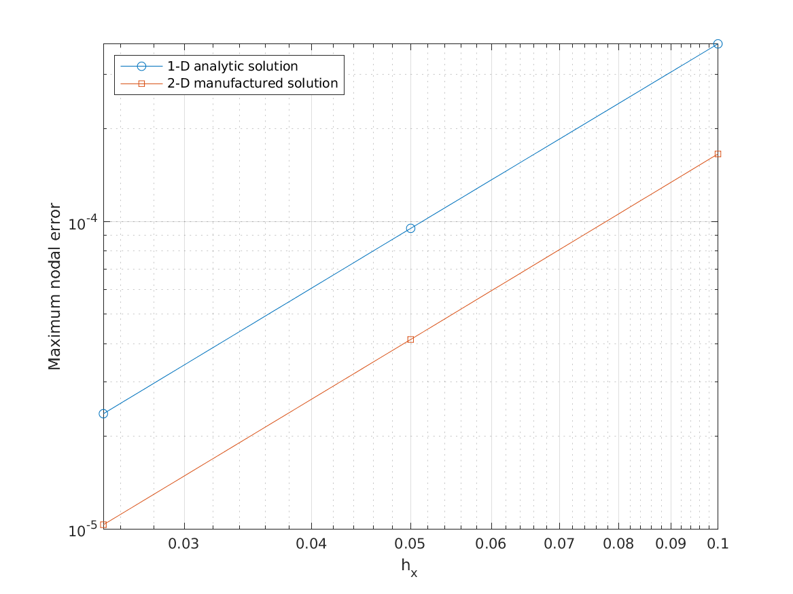
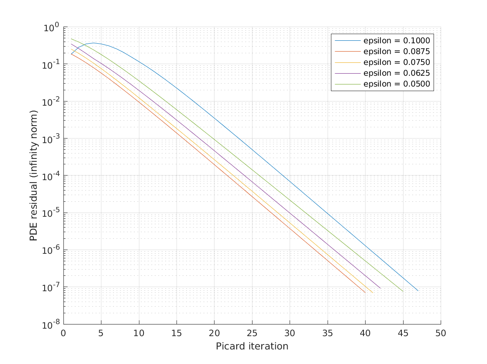
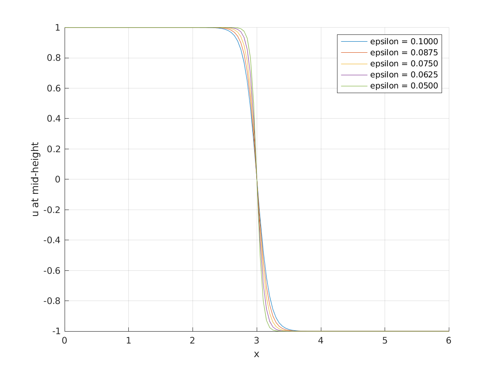
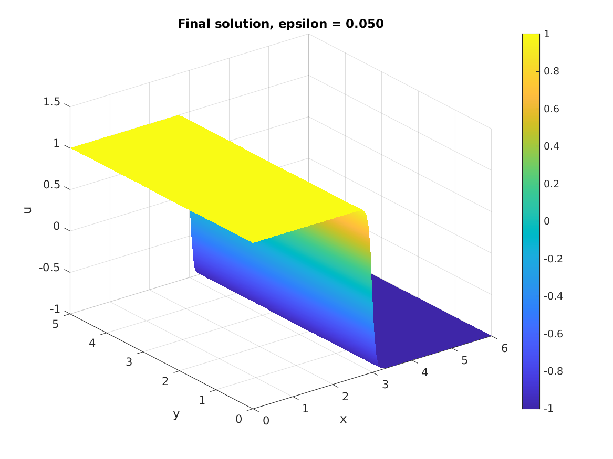

# Measured test results

All results below come from **MATLAB 24.2.0.3361896 (R2024b), Update 10**, on an Ubuntu GitHub-hosted runner.

- Grid refinement tests: [CI run](https://github.com/dchwu2003/Non-linear-PDE-solver/actions/runs/40029637502) on 2026-10-23, code version [`3a89a08501076936d17c97f0cd1213e4c75a5bb1`](https://github.com/dchwu2003/Non-linear-PDE-solver/commit/3a89a08501076936d17c97f0cd1213e4c75a5bb1).
- Default example: [CI run](https://github.com/dchwu2003/Non-linear-PDE-solver/actions/runs/45551286221) on 2026-11-25, code version [`d9217f36a020086f1d1273389697eb9511c7196d`](https://github.com/dchwu2003/Non-linear-PDE-solver/commit/d9217f36a020086f1d1273389697eb9511c7196d), after the default right boundary value was changed from -1.1 to -1. The test problems do not use the default boundary values. This run reproduced the grid refinement table below to the digits shown.

Both runs passed the tests and the full example, including figure generation. The CSV files and figures in this repository are copies of those runs' output, not hand-made examples. Running the commands in the README writes new outputs to `results/` and does not overwrite these copies.

## Grid refinement at fixed ε

Both test problems use ε = 0.2 on `[0,2] x [0,1]`. Both grid spacings halve from one grid to the next. The error is the largest difference from the exact solution at the nodes. The observed order is `log2(error_coarse/error_fine)`.

| Grid | Error, x-only test | Order | Error, x–y test | Order |
|---|---:|---:|---:|---:|
| 21 x 13 | 3.776507e-4 | — | 1.656320e-4 | — |
| 41 x 25 | 9.488772e-5 | 1.9928 | 4.130739e-5 | 2.0035 |
| 81 x 49 | 2.369195e-5 | 2.0018 | 1.032057e-5 | 2.0009 |

Each x-only solve took 48 iterations, and each x–y solve took 35. Residuals recomputed directly from the finite-difference formulas were below `7.1e-12` in every case. For the x–y test, the separately estimated boundary-derivative error went from `4.2028e-4` to `6.6035e-6` over these grids. This fast decrease is specific to this smooth test function and should not be read as a general accuracy result.

Full-precision data: [analytic.csv](data/analytic.csv) (x-only test), [manufactured.csv](data/manufactured.csv) (x–y test). [numerical-method.md](numerical-method.md) gives the formulas and boundary conventions.

## Default example: lowering ε step by step

The example uses 121 x 61 nodes on `[0,6] x [0,5]`, left/right values 1 and -1, zero y derivatives on the top and bottom, relaxation 0.5, relative update tolerance `1e-8`, and absolute residual tolerance `1e-7`. Every ε value is solved. The change in the solution from one ε to the next is recorded but is not used to stop.

The boundary values match the December 2025 poster (+1/−1). The ε range and grid differ from the poster's run (ε down to 0.01, 320×270 grid).

| ε | Iterations | Final residual | Maximum cell Péclet number |
|---|---:|---:|---:|
| 0.1000 | 47 | 7.8489e-8 | 0.250 |
| 0.0875 | 40 | 7.0058e-8 | 0.286 |
| 0.0750 | 41 | 6.9440e-8 | 0.333 |
| 0.0625 | 42 | 9.1954e-8 | 0.400 |
| 0.0500 | 45 | 7.5689e-8 | 0.500 |

At each ε, the residual drops steadily after the first few iterations. The sparse matrices are built once per ε. We make no claims about speed.

The boundary values are equal and opposite, so the solution has flat states at 1 and -1 with a thin layer between them in the middle of the domain. At mid-height, the solution crosses zero at x = 3 for every ε, and the layer gets thinner as ε decreases. An unequal value such as -1.1 on the right pushes the layer toward the left boundary. For these boundary data the solution does not depend on y. The small residuals show that the iteration solved the discrete equations. They do not measure how accurate the grid is in the thin layer. The grid refinement results above apply only to those two test problems and their settings.

Full-precision data: [continuation.csv](data/continuation.csv). The CI artifact `matlab-validation` contains the full solution arrays and histories in `example.mat` and the test report in `validation.mat`, subject to GitHub's artifact retention policy. The figures and CSV copies stay in the repository.

## Other checks

The same run also checked:

- zero and nonzero constant solutions;
- a linear field with nonzero top/bottom derivatives and a perturbed starting guess on a non-square grid;
- residuals recomputed from the formulas, and errors in the fixed boundary values;
- that the solver does not report convergence with a tiny relaxation and a large residual;
- rejection of invalid ε, boundary lengths and relaxation inputs;
- that the boundary-derivative error of the x–y test decreases under refinement.

CI reports success only if all assertions pass. The workflow runs on pull requests and branch pushes, using MATLAB R2024b without extra toolboxes.
